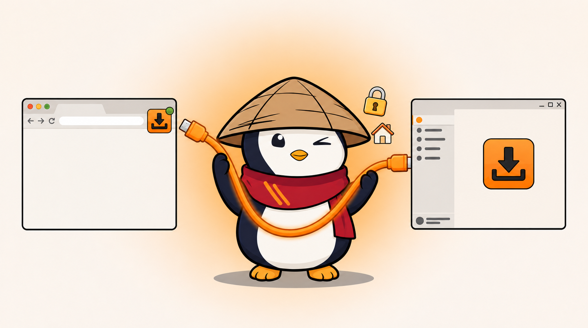

<p align="center">
  <a href="https://github.com/OpenSelena/libreget">
    
  </a>
</p>

<h1 align="center">LibreGet Extension</h1>

<p align="center">
  Browser extension companion for <a href="https://github.com/OpenSelena/libreget">LibreGet</a>.<br>
  Detects video streams, audio, and playlists while you browse and sends them directly to your desktop app.
</p>

<p align="center">
  <a href="https://github.com/OpenSelena/libreget-extension/releases/latest"></a>
  <a href="https://microsoftedge.microsoft.com/addons/detail/idgicdkhanahmhplpeamffngojdjjgdm"></a>
  <a href="https://addons.mozilla.org/en-US/firefox/addon/libreget/"></a>
  <a href="LICENSE"></a>
</p>

<p align="center">
  
</p>

## Installation

### Microsoft Edge
 Install directly from the official Microsoft Edge Add-ons store:
- [Microsoft Edge Add-ons](https://microsoftedge.microsoft.com/addons/detail/idgicdkhanahmhplpeamffngojdjjgdm)

### Firefox
 Install directly from the official Mozilla Add-ons directory:
- [Firefox Add-ons (AMO)](https://addons.mozilla.org/en-US/firefox/addon/libreget/)

### Chrome, Brave, Opera
1. Download `libreget-chrome-extension.zip` from [Releases](https://github.com/OpenSelena/libreget-extension/releases/latest) and extract it.
2. Open `chrome://extensions` (or your Chromium browser's extensions page).
3. Turn on **Developer mode** (top-right corner).
4. Click **Load unpacked** and select the extracted folder.

*(You can also install directly from the LibreGet desktop app under **Settings → Plugins → Browser extension**).*

## How to use

1. Open the **[LibreGet](https://github.com/OpenSelena/libreget)** desktop app on your computer.
2. Visit any webpage playing media.
3. Click the LibreGet icon in your browser toolbar (or press `Alt+O`).
4. Select the stream or track you want and click **Download**.

The extension sends the stream URL, headers, and your active session cookies directly to LibreGet over local loopback (`127.0.0.1:47720`). If the app is closed, it falls back to the `libreget://` URL protocol to queue the task.

## What it does

- **Stream sniffer**: Captures HLS (`.m3u8`), DASH (`.mpd`), MP4, WebM, and direct audio streams as they play.
- **Track pairing**: Automatically merges separate video and audio streams into a single download task.
- **Cookie forwarding**: Passes authentication cookies for logged-in sites (Udemy, Hotmart, private course portals) so downloads don't fail with 403 errors.
- **Deep search**: An optional popup switch that hooks into video player contexts to discover hidden streams not exposed in raw network calls.
- **Force H.264**: A quick toggle for YouTube to force AVC/H.264 on older hardware that lags when decoding VP9 or AV1.
- **Capture rules**: Custom regex, file size floors, and domain blocklists configurable in the options page.

## Privacy

The extension connects only to `127.0.0.1` on your own machine. It has zero analytics, zero telemetry, and never contacts third-party servers. Your browsing history and cookies never leave your computer.

## Development

```bash
git clone https://github.com/OpenSelena/libreget-extension.git
cd libreget-extension

# Run tests (417 unit tests)
npm test

# Sync changes between Chrome and Firefox targets
npm run sync

# Build release zip packages to dist/
npm run build
```

## License

GNU General Public License v3.0. See [LICENSE](LICENSE) for details.

Maintained by [Igect](https://github.com/igect) under the [OpenSelena](https://github.com/OpenSelena) organization.
